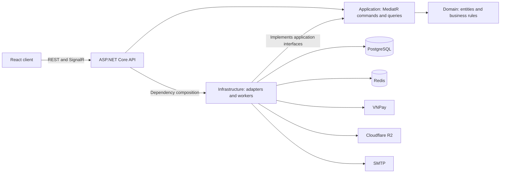

# TutorHub

**An online tutoring marketplace with session-based payments, scheduling, and dispute resolution.**

[](https://github.com/NguyenNguyen0210/TutorHub/actions/workflows/ci.yml)


[Overview](#overview) | [Demo & Screenshots](#demo--screenshots) | [Key Features](#key-features) | [Tech Stack](#tech-stack) | [Architecture](#architecture) | [Project Structure](#project-structure) | [Getting Started](#getting-started) | [Configuration](#configuration) | [API Documentation](#api-documentation) | [Testing](#testing) | [Deployment](#deployment) | [Roadmap](#roadmap) | [License & Author](#license--author)

## Overview

TutorHub connects students with tutors through structured learning packages. It brings tutor discovery, package purchases, lesson scheduling, and tuition settlement into one workflow, including dispute resolution when a lesson does not go as expected.

This personal full-stack project focuses on backend business rules, financial consistency, and asynchronous processing, with a React interface for students, tutors, and administrators.

## Demo & Screenshots

Run the [local demo](#getting-started) to explore the application at <http://localhost:5173> with seeded student, tutor, and administrator accounts. A public demo URL and product screenshots have not been verified for this README.

### Suggested demo walkthrough

1. Sign in as the student and purchase the demo package using the fictional wallet balance.
2. Sign in as the tutor in a separate browser session and schedule the enrolled lessons.
3. Open the student schedule and exchange messages with the tutor.
4. Sign in as the administrator to explore enrollment, user, financial, and audit views.

Dispute and automatic payout flows depend on session end times and the review window. Use a separate test database when exercising financial scenarios.

## Key Features

| Role | Capabilities |
| --- | --- |
| Student | Discover tutors and packages, save favorites, pay through VNPay or a wallet, view schedules, chat, submit disputes, and request withdrawals. |
| Tutor | Submit an application for approval, manage learning packages, schedule and reschedule lessons, maintain lesson records, and track earnings. |
| Administrator | Review tutor applications and packages, manage users and catalog data, resolve disputes, process withdrawal requests, and inspect audit logs. |

### Payment and escrow workflow

1. **Reserve:** a booking holds a package purchase for 15 minutes while awaiting payment.
2. **Activate:** successful payment creates an enrollment and its learning sessions.
3. **Schedule:** the tutor schedules lessons. Applicable scheduling and cancellation operations enforce a configurable notice period, defaulting to two hours.
4. **Hold:** after a lesson ends, a background worker moves it into a 12-hour review window before releasing tuition.
5. **Settle:** eligible sessions without an issue report are paid out to the tutor's wallet. A dispute holds the relevant funds for administrator review.

Administrators can issue a full or partial refund, release tutor earnings, or dismiss a dispute without an immediate financial adjustment. Wallets track available, pending, and withdrawing balances separately; balance movements are recorded for reconciliation. Wallet payout and external bank transfer are separate operations.

## Tech Stack

| Area | Technologies |
| --- | --- |
| Backend | C#, .NET 8, ASP.NET Core Web API, MediatR, FluentValidation |
| Persistence | PostgreSQL 16, EF Core 8, Npgsql |
| Cache and coordination | Redis 7 |
| Frontend | React 18, Vite 5, Tailwind CSS, React Router, TanStack Query, Zustand, Axios |
| Integrations | VNPay, ASP.NET Core SignalR, Cloudflare R2 / S3 API, MailKit SMTP, optional Google sign-in |
| Testing | xUnit, FluentAssertions, Moq, ASP.NET Core integration tests, Node.js test runner |
| Operations | Docker Compose, GitHub Actions, Serilog, health checks |

## Architecture

The backend follows **Clean Architecture** with **CQRS through MediatR**, organized around application features.



Arrows between backend layers show project references; arrows to external services show runtime communication. Background workers run inside the API process.

| Project | Responsibility |
| --- | --- |
| `TutorHub.Domain` | Entities, lifecycle transitions, and business rules. |
| `TutorHub.Application` | Commands, queries, validation, policies, and infrastructure interfaces. |
| `TutorHub.Infrastructure` | EF Core persistence, Redis, background workers, SignalR, and external integrations. |
| `TutorHub.Api` | REST controllers, authentication, middleware, endpoint registration, and dependency composition. |
| React client | Role-specific screens, API integration, server-state caching, and realtime interactions. |

### Engineering highlights

- **Financial consistency:** PostgreSQL transactions, row locks, and advisory locks serialize relevant updates to wallets, enrollment progress, and review aggregates.
- **Retry handling:** request idempotency protects supported operations from duplicate submissions; transactional outbox processing separates committed business changes from notification delivery.
- **Background processing:** workers handle booking expiration, session payouts, outbox dispatch, email delivery, and idempotency cleanup. Redis coordinates distributed worker execution; database locks protect the underlying data updates.
- **Authentication:** JWT access tokens, refresh-token rotation, and role-based authorization. Established SignalR connections revalidate account status and token version.
- **Realtime and storage:** SignalR supports chat and notifications; Cloudflare R2 stores uploaded media and dispute evidence.
- **Auditability:** append-only database triggers protect the corresponding financial and audit records.

## Project Structure

```text
src/
├── backend/
│   ├── TutorHub.Api/
│   ├── TutorHub.Application/
│   ├── TutorHub.Domain/
│   ├── TutorHub.Infrastructure/
│   └── TutorHub.sln
├── frontend/
│   ├── src/                 # Pages, components, services, state, utilities
│   └── test/                # Frontend regression tests
└── test/                    # Backend unit and integration tests
docs/                        # Requirements, user stories, OpenAPI snapshot
docker-compose.yml           # Local PostgreSQL, Redis, and API services
docker-compose.prod.yml      # Production container configuration
.env.example                 # Local configuration template
.env.production.example      # Deployment configuration template
```

## Getting Started

### Prerequisites

- .NET 8 SDK.
- Node.js 20 or later and npm.
- Docker Compose, or an existing local PostgreSQL 16 and Redis 7 instance.
- Valid VNPay and Cloudflare R2 configuration for API startup; use VNPay sandbox for development payments.

The commands below use **PowerShell**. Run them from the repository root unless another directory is specified.

### 1. Clone and configure

```powershell
git clone https://github.com/NguyenNguyen0210/TutorHub.git
cd TutorHub
Copy-Item .env.example .env
```

Update `.env` with your local connection details and integration credentials. The API rejects placeholder secrets such as `change_me`. In Development, its dotenv loader reads the local file without overriding existing process environment variables.

See [Configuration](#configuration) for the required backend settings before continuing.

### 2. Start PostgreSQL and Redis

```powershell
docker compose up -d postgres redis
```

Default PostgreSQL settings are database/user/password `tutorhub`, exposed on host port `5433`. Redis is exposed on `6379`. If you customize database credentials, keep the API connection string consistent with the PostgreSQL volume's existing credentials.

### 3. Initialize a local demo database

For an empty application database:

```powershell
dotnet restore src/backend/TutorHub.sln
dotnet run --project src/backend/TutorHub.Api --launch-profile http -- --seed-demo
```

This command applies EF Core migrations and creates three demo accounts, a published learning package, and a student wallet. It only runs in Development against localhost PostgreSQL. It refuses unrelated existing application data; rerunning with the demo accounts already present leaves accounts and balances unchanged.

| Role | Email | Password |
| --- | --- | --- |
| Administrator | `admin.demo@tutorhub.local` | `Demo@12345` |
| Tutor | `tutor.demo@tutorhub.local` | `Demo@12345` |
| Student | `student.demo@tutorhub.local` | `Demo@12345` |

The student starts with **1,000,000 fictional VND** for wallet-based purchases. These are local demonstration accounts and balances, not real deposits. No external SQL files or local utility scripts are required.

### 4. Run the API

```powershell
dotnet run --project src/backend/TutorHub.Api --launch-profile http
```

### 5. Run the frontend

In a separate terminal:

```powershell
cd src/frontend
npm ci
npm run dev
```

| Service | Local URL |
| --- | --- |
| Web application | <http://localhost:5173> |
| API | <http://localhost:5129> |
| Swagger UI — Development only | <http://localhost:5129/swagger> |
| Readiness — PostgreSQL and Redis | <http://localhost:5129/health> |
| Liveness | <http://localhost:5129/health/live> |

## Configuration

### Backend

The [local environment template](.env.example) documents backend settings. The API uses .NET configuration paths with double underscores (`Jwt__Secret`); the [production template](.env.production.example) uses Compose variable names that are mapped to those API settings.

| Configuration | Purpose |
| --- | --- |
| `ConnectionStrings__DefaultConnection` | PostgreSQL connection; the template uses `localhost:5433`. |
| `ConnectionStrings__Redis` | Redis connection; the local default is `localhost:6379`. |
| `Jwt__Secret`, `RefreshToken__Pepper` | Separate random values of at least 32 characters each. |
| `VnPay__TmnCode`, `VnPay__HashSecret`, `VnPay__BaseUrl` | VNPay merchant credentials and sandbox gateway URL. |
| `VnPay__ReturnUrl` | Use `http://localhost:5173/payment/return` for the frontend payment result page. |
| `CloudflareR2__AccountId`, `CloudflareR2__AccessKeyId`, `CloudflareR2__SecretAccessKey` | Object storage credentials. |
| `CloudflareR2__BucketName` | Add this setting when running the API directly on the host. |
| `Cors__AllowedOrigins` | Set to `http://localhost:5173` for the local frontend. |
| `Smtp__*` | Email delivery; leaving the host empty enables log-only delivery in Development. |
| `ExternalAuth__Google__*` | Optional Google sign-in; leave empty to disable. |

Compose maps `CLOUDFLARE_R2_BUCKET` to the API's `CloudflareR2__BucketName`. Host-based development needs the latter configuration key directly. Keep credentials in local environment files or deployment secrets; `VITE_*` variables are exposed to the browser.

### Frontend

The frontend defaults to the API on port `5129`. To change endpoints, create `src/frontend/.env.local`:

```dotenv
VITE_API_BASE_URL=http://localhost:5129/api/v1
VITE_SIGNALR_HUB_URL=http://localhost:5129/hubs/chat
VITE_NOTIFICATION_HUB_URL=http://localhost:5129/hubs/notifications
```

Restart Vite after changing environment variables. When changing the frontend address, update CORS and the VNPay return URL as well.

## API Documentation

The local API base URL is `http://localhost:5129/api/v1`. [Swagger UI](http://localhost:5129/swagger) is available in Development and describes request bodies, responses, and authorization requirements.

### Authentication

1. Call `POST /api/v1/auth/login` with an email and password from the local demo accounts or a registered account.
2. Use the returned `data.accessToken` in `Authorization: Bearer <access-token>` for protected requests. In Swagger's **Authorize** dialog, paste only the token; Swagger adds the prefix.
3. Call `POST /api/v1/auth/refresh` with the refresh token when needed. Refresh tokens rotate; retain the new token pair returned by the API.
4. Call `POST /api/v1/auth/logout` with the refresh token to revoke it. Protected operations also enforce student, tutor, or administrator permissions.

### Endpoint groups

Paths below are relative to `/api/v1`; consult Swagger for individual operations and permissions.

| Group | Paths | Purpose |
| --- | --- | --- |
| Authentication | `/auth` | Registration, login, token refresh, password recovery, optional Google sign-in. |
| Discovery | `/tutors`, `/services`, `/subjects`, `/categories` | Tutor profiles, learning packages, and catalog data. |
| Learning | `/bookings`, `/enrollments`, `/sessions` | Package reservations, enrollments, and lesson scheduling. |
| Finance | `/payments`, `/wallets/me`, `/transactions`, `/disputes` | VNPay payments, wallet balances, transactions, and disputes. |
| Communication | `/conversations`, `/notifications`, `/media` | Messaging, notifications, and uploaded media. |
| Administration | `/admin` | Moderation, disputes, withdrawals, platform settings, and audit records. |

### Further documentation

- [Functional requirements](docs/functional-requirements.md)
- [Product requirements](docs/prd.md)
- [User stories](docs/user-stories.md)
- [OpenAPI snapshot](docs/openapi.json) — use the running API's Swagger UI for its current contract.

## Testing

### Backend

```powershell
dotnet build src/backend/TutorHub.sln --configuration Release /p:TreatWarningsAsErrors=true
dotnet test src/backend/TutorHub.sln --configuration Release --no-build
```

Integration tests use local PostgreSQL and Redis. The database connection is read from the environment or `.env`; the PostgreSQL user needs permission to create and drop the dedicated test database. The harness refuses remote hosts and restricts database names to `tutorhub_integration` or an allowed underscore suffix.

To use a separate test database name:

```powershell
$env:POSTGRES_TEST_DATABASE='tutorhub_integration_local'
dotnet test src/test/TutorHub.Api.IntegrationTests --configuration Release
```

### Frontend

From `src/frontend`:

```powershell
npm run lint
npm test
npm run build
```

Versioned regression tests are in `src/test` and `src/frontend/test`. They cover domain rules, application handlers, infrastructure behavior, and API/database integration, including financial concurrency and authentication scenarios. Browser E2E checks use Playwright separately; local runners and generated reports are not distributed with this repository.

The [CI workflow](.github/workflows/ci.yml) defines backend build/tests and frontend lint/tests/build for pushes and pull requests targeting `main`. Check workflow results for the specific commit under review.

## Deployment

### Production containers

Copy the production template and fill in its required values before starting the stack:

```powershell
Copy-Item .env.production.example .env.production
docker compose -f docker-compose.prod.yml --env-file .env.production up -d --build
```

This starts the API, PostgreSQL, and Redis; host the frontend separately. From `src/frontend`, set the production `VITE_*` endpoints and run `npm ci` followed by `npm run build`. Publish `dist/` to a static host with an SPA fallback to `index.html`, and route HTTPS traffic to the API through your reverse proxy.

[Production Compose](docker-compose.prod.yml) and the [production environment template](.env.production.example) provide the deployment configuration starting point.

- The local Compose API service exposes host port `8080`, uses internal PostgreSQL/Redis hostnames, and enables startup migrations. The frontend is run separately.
- The `--seed-demo` command is intended for host-based local development; its localhost restriction excludes the Compose PostgreSQL hostname.
- Outside Development, provide configuration through deployment environment variables, including valid SMTP and allowed browser origins. Swagger is Development-only.
- Configure trusted reverse proxy IPs through `ReverseProxy__KnownProxies__0`, `ReverseProxy__KnownProxies__1`, and so on.
- Use `/health` for dependency readiness and `/health/live` for process liveness.

### Continuous integration

GitHub Actions runs backend build/tests and frontend lint/tests/build on pushes and pull requests to `main`. The workflow validates changes; deployment is performed separately.

## Roadmap

The following are proposed portfolio improvements, not a committed delivery schedule:

- [ ] Add product screenshots covering discovery, scheduling, and administration.
- [ ] Publish a documented public demo with a controlled demonstration dataset.
- [ ] Add a shared browser E2E suite to CI for the main student and tutor journeys.

Implemented capabilities are listed under [Key Features](#key-features).

## License & Author

Developed by [Nguyen Nguyen](https://github.com/NguyenNguyen0210).

No license file is currently included in this repository; a project license has not been specified.
