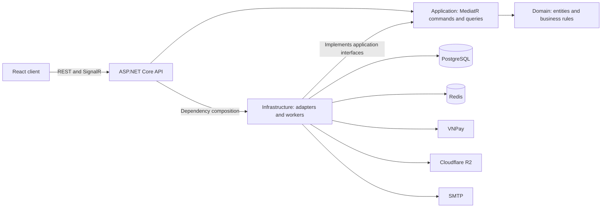

# TutorHub

**An online tutoring marketplace with session-based payments, scheduling, and dispute resolution.**

[](https://github.com/NguyenNguyen0210/TutorHub/actions/workflows/ci.yml)


[Live demo](https://tutorhub.id.vn/) · [Engineering highlights](#engineering-highlights) · [Architecture](#architecture) · [Quick start](#quick-start)

TutorHub connects students with tutors through learning packages. Students purchase a package, tutors schedule lessons, and tuition is held through a post-lesson review window before settlement. This personal full-stack project focuses on financial consistency, concurrent workflows, and asynchronous delivery.

## Try it now

Explore **[tutorhub.id.vn](https://tutorhub.id.vn/)** with these shared demo accounts. The password for all three is `Test@123`.

| Workspace | Email | What to explore |
| --- | --- | --- |
| Student | `hocvien.baokhanh@tutorhub.vn` | Package checkout, lesson schedules, chat, reviews, and disputes. |
| Tutor | `tutor.bao@tutorhub.vn` | Package management, scheduling, lesson records, and earnings. |
| Administrator | `admin@tutorhub.vn` | Tutor approval, dispute resolution, withdrawal review, and audit logs. |

For a payment walkthrough, [run locally](#quick-start) with VNPay sandbox configuration.

## Engineering highlights

| Problem | Solution |
| --- | --- |
| Concurrent financial requests must not settle the same funds twice | PostgreSQL transactions, row locks, and advisory locks serialize relevant wallet and settlement updates; integration tests exercise financial concurrency. |
| Client retries can repeat a completed operation | Idempotency keys on supported operations prevent duplicate processing. |
| Notifications must follow committed business changes | A transactional outbox records events with the business transaction; background workers dispatch notifications and retry email delivery. |
| Multiple API instances can compete for scheduled work | Redis distributed locks coordinate workers; database locks protect underlying financial updates. |
| Tuition needs a review period before release | Booking reservation → payment activation → scheduled lesson → 12-hour post-lesson review window → settlement or dispute handling. |
| Financial and administrative history must remain auditable | Append-only database triggers protect transaction and audit records; wallet movements have a separate ledger. |

Authentication uses JWT access tokens, rotating refresh tokens, and role-based authorization. SignalR connections revalidate account status and token version.

## Architecture

The backend follows **Clean Architecture** with **CQRS through MediatR**, organized around application features.



Arrows between backend layers show project references; arrows to external services show runtime communication. Background workers run inside the API process.

| Project | Responsibility |
| --- | --- |
| `TutorHub.Domain` | Entities, lifecycle transitions, and business rules. |
| `TutorHub.Application` | Commands, queries, validation, policies, and infrastructure interfaces. |
| `TutorHub.Infrastructure` | EF Core persistence, Redis, background workers, SignalR, and external integrations. |
| `TutorHub.Api` | REST controllers, authentication, middleware, endpoint registration, and dependency composition. |
| React client | Role-specific screens, API integration, server-state caching, and realtime interactions. |

## Tech stack

| Area | Technologies |
| --- | --- |
| API | C#, .NET 8, ASP.NET Core, MediatR, FluentValidation |
| Data | PostgreSQL 16, EF Core 8, Redis 7 |
| Web | React 18, Vite 5, Tailwind CSS, TanStack Query, Zustand |
| Integrations | VNPay, SignalR, Cloudflare R2, MailKit SMTP |
| Quality | xUnit, FluentAssertions, Moq, Node.js test runner |
| Operations | Docker Compose, GitHub Actions, Serilog, health checks |

## Quick start

**Requires VNPay sandbox and Cloudflare R2 configuration**, plus .NET 8, Node.js 20+, and Docker Compose. Follow the [setup and environment guide](docs/configuration.md) to fill in `.env` before starting the API.

```powershell
git clone https://github.com/NguyenNguyen0210/TutorHub.git
cd TutorHub
Copy-Item .env.example .env
# Fill in .env using docs/configuration.md, then:
docker compose up -d postgres redis
```

Apply migrations and start the API:

```powershell
dotnet restore src/backend/TutorHub.sln
dotnet ef database update --project src/backend/TutorHub.Infrastructure --startup-project src/backend/TutorHub.Api
dotnet run --project src/backend/TutorHub.Api --launch-profile http
```

In a separate terminal:

```powershell
cd src/frontend
npm ci
npm run dev
```

Web: <http://localhost:5173> · API: <http://localhost:5129> · Swagger (Development): <http://localhost:5129/swagger>

The frontend runs separately from Compose. The Development-only payment simulator can exercise the VNPay callback flow, but does not remove startup configuration requirements. See [API documentation](docs/api.md) and [production deployment](docs/deployment.md).

## Testing & CI

Backend tests cover domain rules, application handlers, infrastructure, and API integration, including payment concurrency and authentication. API integration tests use PostgreSQL and Redis.

[GitHub Actions](.github/workflows/ci.yml) builds the backend with warnings treated as errors, runs backend tests, and runs frontend lint, regression tests, and production build on pushes and pull requests to `main`.

See [test commands and database setup](docs/testing.md). Shared browser E2E coverage is planned for the checkout and scheduling journeys.

## Known limitations & roadmap

- **Local onboarding:** add a self-contained demo mode with repeatable sample data and local storage/payment adapters.
- **Journey verification:** bring shared browser E2E tests into CI for student checkout and tutor scheduling.
- **Financial safeguards:** extend database-level protections beyond transaction and audit records; wallet, ledger, withdrawal, and top-up guards currently rely on EF Core and can be bypassed by raw SQL.

## Documentation

[Configuration](docs/configuration.md) · [Deployment](docs/deployment.md) · [API reference](docs/api.md) · [Testing](docs/testing.md) · [Requirements](docs/functional-requirements.md) · [User stories](docs/user-stories.md)

## License & author

Developed by [Nguyen Nguyen](https://github.com/NguyenNguyen0210).

A project license has not been specified; no license file is included.
