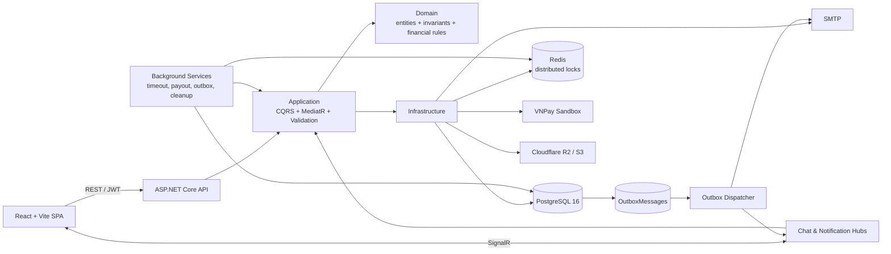
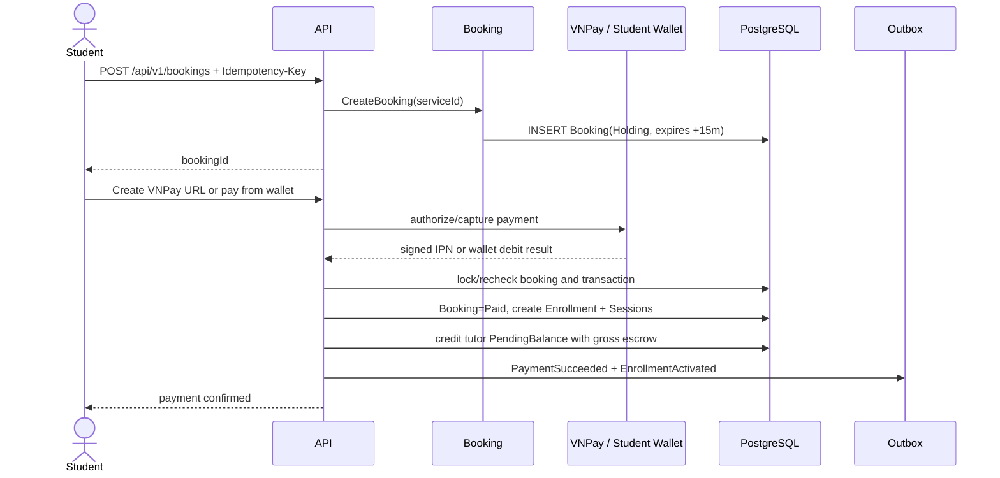

# TutorHub — Portfolio Technical Guide

Tài liệu này là lối vào ngắn dành cho người phỏng vấn hoặc reviewer kỹ thuật. Nó mô tả hành vi đang có trong code và migration hiện tại, không phải roadmap.

## 1. Kiến trúc tổng thể



Backend là **modular monolith** theo Clean Architecture:

- `TutorHub.Domain`: quy tắc nghiệp vụ không phụ thuộc framework.
- `TutorHub.Application`: use case theo feature/CQRS, validation và interface.
- `TutorHub.Infrastructure`: EF Core, PostgreSQL, Redis, VNPay, R2, email và background service.
- `TutorHub.Api`: controller mỏng, authentication, filter, middleware và SignalR hub.

## 2. ERD nghiệp vụ chính

ERD dưới đây chủ ý tập trung vào đường đi của dữ liệu marketplace và tài chính. Các bảng hỗ trợ như refresh token, notification, media, email delivery và idempotency record không được bung toàn bộ để sơ đồ vẫn đọc được.

```mermaid
erDiagram
    USER ||--o| STUDENT_PROFILE : owns
    USER ||--o| TUTOR_PROFILE : owns
    USER ||--o| WALLET : owns
    CATEGORY ||--o{ SUBJECT : groups
    SUBJECT ||--o{ SERVICE : classifies
    TUTOR_PROFILE ||--o{ SERVICE : offers
    STUDENT_PROFILE ||--o{ BOOKING : creates
    TUTOR_PROFILE ||--o{ BOOKING : receives
    SERVICE ||--o{ BOOKING : snapshots
    BOOKING ||--o| ENROLLMENT : activates
    ENROLLMENT ||--|{ SESSION : contains
    BOOKING ||--o{ TRANSACTION : records
    SESSION ||--o{ TRANSACTION : settles
    SESSION ||--o| DISPUTE : may_open
    DISPUTE ||--o{ DISPUTE_EVIDENCE : contains
    DISPUTE ||--o{ TRANSACTION : adjusts
    WALLET ||--o{ WALLET_TRANSACTION : appends
    ENROLLMENT ||--o| REVIEW : receives

    USER {
      uuid Id PK
      string Email UK
      enum Role
      enum Status
    }
    SERVICE {
      uuid Id PK
      uuid TutorProfileId FK
      uuid SubjectId FK
      decimal Price
      int TotalSessions
      enum Status
    }
    BOOKING {
      uuid Id PK
      uuid ServiceId FK
      decimal TotalPrice
      int TotalSessions
      enum Status
      datetime HoldingExpiresAt
    }
    ENROLLMENT {
      uuid Id PK
      uuid BookingId FK_UK
      decimal TotalPrice
      decimal PlatformFeeRate
      enum Status
    }
    SESSION {
      uuid Id PK
      uuid EnrollmentId FK
      int SessionNumber
      decimal SessionPrice
      enum Status
      datetime GracePeriodEndsAt
      bool IsPayoutReleased
    }
    WALLET {
      uuid Id PK
      uuid UserId FK_UK
      decimal AvailableBalance
      decimal PendingBalance
      decimal WithdrawingBalance
    }
    TRANSACTION {
      uuid Id PK
      uuid BookingId FK
      uuid SessionId FK
      uuid DisputeId FK
      enum Type
      enum Status
      decimal Amount
      decimal PlatformFeeAmount
      decimal PayoutAmount
      string PaymentGatewayRef UK
    }
    WALLET_TRANSACTION {
      uuid Id PK
      uuid WalletId FK
      enum Direction
      decimal Amount
      decimal BalanceBefore
      decimal BalanceAfter
    }
    DISPUTE {
      uuid Id PK
      uuid SessionId FK
      enum Status
      decimal HeldAmount
      enum ResolutionDecision
    }
```

Nguồn xác thực schema: EF configurations và migration trong `src/backend/TutorHub.Infrastructure/Persistence`.

## 3. Sequence diagrams

### 3.1 Đặt gói học và thanh toán



### 3.2 Hoàn thành buổi học và giải ngân

```mermaid
sequenceDiagram
    participant Job as AutoPayoutJob
    participant Session
    participant DB as PostgreSQL
    participant Wallet as Tutor Wallet
    participant Outbox

    Job->>DB: find Scheduled sessions with EndAt <= now
    Job->>Session: start 12-hour grace period
    Session->>DB: status=AwaitingPayout
    Note over Session: Student may report issue during grace period
    Job->>DB: find expired grace periods
    Job->>DB: SELECT Session FOR UPDATE
    Job->>DB: reject if issue/dispute/released
    Job->>Wallet: debit Pending gross; credit Available net
    Job->>DB: append payout Transaction + WalletTransaction
    Job->>Session: mark Completed and payout released
    Job->>Outbox: SessionCompleted + EarningCreated
```

### 3.3 Khiếu nại và admin phân xử

```mermaid
sequenceDiagram
    actor Student
    actor Admin
    participant API
    participant DB as PostgreSQL
    participant TutorWallet
    participant StudentWallet

    Student->>API: report issue / create dispute in grace period
    API->>DB: freeze payout and create EscrowHold
    Student->>API: upload evidence
    Admin->>API: resolve dispute
    API->>DB: SELECT Dispute FOR UPDATE
    API->>TutorWallet: lock wallet; debit pending gross
    alt student refund
        API->>StudentWallet: credit refund
        API->>DB: append StudentRefund + wallet ledger
    end
    alt tutor receives share
        API->>TutorWallet: credit net after platform fee
        API->>DB: append SessionPayoutCredit + wallet ledger
    end
    API->>DB: close dispute, complete session, append audit/outbox
    API-->>Admin: resolved result
```

## 4. Demo accounts

Sau khi nạp `src/backend/seedData.sql`, mọi tài khoản dưới đây dùng mật khẩu `Test@123`.

| Vai trò | Email | Gợi ý demo |
| --- | --- | --- |
| Admin | `admin@tutorhub.test` | dashboard, hồ sơ gia sư, tranh chấp, ví và audit log |
| Tutor | `gia-su01@tutorhub.test` | dịch vụ, enrollment, lịch học và ví gia sư |
| Tutor | `gia-su02@tutorhub.test` | dữ liệu dịch vụ/đánh giá khác để so sánh |
| Student | `hoc-vien01@tutorhub.test` | khám phá dịch vụ, booking, thanh toán và buổi học |
| Student | `hoc-vien02@tutorhub.test` | lịch sử booking và ví học viên khác |

Đây chỉ là dữ liệu giả lập. Không dùng các tài khoản này ngoài môi trường demo/development.

## 5. Swagger và đăng nhập

1. Chạy API ở môi trường `Development` và mở `http://localhost:8080/swagger`.
2. Gọi `POST /api/v1/auth/login`:

```json
{
  "email": "hoc-vien01@tutorhub.test",
  "password": "Test@123"
}
```

3. Lấy `data.accessToken` trong response.
4. Nhấn **Authorize** trong Swagger và nhập `Bearer <accessToken>`.
5. Với các mutation tài chính/booking, thêm header `Idempotency-Key` là một UUID mới, ví dụ `550e8400-e29b-41d4-a716-446655440000`.
6. Thử theo thứ tự: `GET /api/v1/services` → `POST /api/v1/bookings` → `POST /api/v1/payments/{bookingId}/wallet` → `GET /api/v1/enrollments`.

Swagger được bật cho development; production không nên công khai Swagger nếu chưa có kiểm soát truy cập phù hợp.

## 6. Technical decisions

### Vì sao modular monolith?

Quy mô TutorHub phù hợp một deployable backend nhưng vẫn cần ranh giới rõ giữa identity, marketplace, learning, payment và dispute. Modular monolith giảm chi phí vận hành và distributed transaction của microservices, trong khi Clean Architecture + feature folders vẫn giữ nghiệp vụ tách biệt. Nếu lưu lượng hoặc ownership thay đổi, outbox event là seam để tách module thành service sau này.

### Vì sao dùng transactional outbox?

Thay đổi trạng thái tài chính và yêu cầu gửi notification phải được ghi nhận cùng một transaction database. Handler ghi domain event vào `OutboxMessages`; dispatcher claim bằng lease, retry và dead-letter. Nhờ đó commit nghiệp vụ không phụ thuộc SignalR/SMTP đang online, đồng thời không có khoảng trống “đã trừ tiền nhưng quên phát event”. Delivery là at-least-once, nên consumer vẫn phải idempotent.

### Cách chống double payment

Hệ thống dùng nhiều lớp thay vì chỉ một cờ boolean:

- `Idempotency-Key` lưu theo user + payload và replay response cho request lặp.
- `PaymentGatewayRef` có unique filtered index.
- Webhook kiểm chữ ký, merchant reference, số tiền và trạng thái hiện tại.
- Booking/transaction được khóa và recheck trước khi activate enrollment.
- Enrollment chỉ có một quan hệ kích hoạt từ booking; wallet/escrow mutation nằm cùng transaction.
- Regression test kiểm tra webhook lặp và concurrent capture.

### Cách xử lý concurrency

- PostgreSQL `SELECT ... FOR UPDATE` khóa session, dispute và wallet theo đường tiền.
- `xmin` làm optimistic concurrency token cho entity cần phát hiện lost update.
- Unique constraints là hàng rào cuối cho gateway reference, outbox event và idempotency record.
- Redis distributed lock đảm bảo background job chỉ có một worker chủ động mỗi chu kỳ.
- Mỗi session payout chạy trong transaction/scope riêng để một payout lỗi không làm bẩn payout tiếp theo.

### Vì sao ledger và audit log append-only?

Sửa/xóa lịch sử làm mất khả năng đối soát. TutorHub ghi adjustment/refund thành record mới, giữ `BalanceBefore`/`BalanceAfter` và reference tới nghiệp vụ gốc. `Transactions` và `AuditLogs` được bảo vệ bằng PostgreSQL trigger; `WalletTransactions` còn được chặn tại `AppDbContext`. Cách này tạo audit trail có thể tái dựng và làm rõ ai/điều gì đã thay đổi số dư.

## 7. Verification nhanh

```powershell
# PostgreSQL container phải chạy; script tự đọc POSTGRES_PASSWORD từ .env
.\scripts\test-backend.ps1

Set-Location src/frontend
npm run lint
npm test
npm run build
```

Ba integration test có trait `Category=CriticalFlow` bảo vệ trực tiếp:

- booking → payment webhook → enrollment + gross escrow;
- expired grace period → payout + tutor wallet ledger;
- dispute partial refund → tutor/student wallets + ledger.

Chạy riêng nhóm này:

```powershell
dotnet test src/test/TutorHub.Api.IntegrationTests --configuration Release --filter "Category=CriticalFlow"
```
